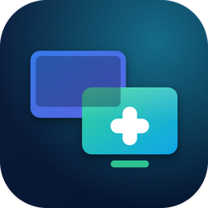

# Destek+

Windows ve macOS için ücretsiz uzak masaüstü uygulaması. Açık kaynak
[RustDesk](https://github.com/rustdesk/rustdesk) (1.5.1) üzerine kuruludur.

## Özellikler

- **Sabit cihaz ID'si:** Her bilgisayarın kalıcı bir ID'si olur. Ana ekrandaki ID'nin yanındaki
  menüden **ID'yi değiştir** diyerek akılda kalan bir ad verebilirsin (ör. `ofis-pc`, `ahmet-mac`).
- **Kabul et / Reddet ekranı:** Biri bağlanmak istediğinde karşı tarafta onay penceresi çıkar.
- **Gözetimsiz erişim:** Başında kimse yokken bağlanmak için **Ayarlar > Güvenlik > Kalıcı
  şifre** kısmından sabit bir şifre belirle. Bilgisayar açık olduğu sürece bu şifreyle bağlanırsın.
- **Arka planda çalışma:** Kurulumdan sonra servis olarak açılışta başlar, pencere kapalı olsa da
  bağlantı kabul eder.
- **Windows ↔ Mac:** Windows'tan Mac'e, Mac'ten Windows'a bağlanılır. Dosya aktarımı, pano
  paylaşımı ve sohbet de vardır.

## Kurulum dosyaları

GitHub'da **Releases** sayfasından indir:

- Windows: `destek-plus-<sürüm>-windows-x86_64.exe` (çalıştır, **Kur** de)
- Mac (M1/M2/M3/M4): `destek-plus-<sürüm>-macos-aarch64.dmg`
- Mac (Intel): `destek-plus-<sürüm>-macos-x86_64.dmg`

### Windows notu
Uygulama imzalı olmadığı için SmartScreen uyarı verir: **Ek bilgi > Yine de çalıştır**.

### Mac notu
1. DMG'yi aç, Destek+'ı **Uygulamalar** klasörüne sürükle.
2. İlk açılışta "doğrulanamadı" derse: Uygulamalar'da Destek+'a **sağ tık > Aç**
   (veya Sistem Ayarları > Gizlilik ve Güvenlik > **Yine de aç**).
   "Hasar görmüş" derse Terminal'de şunu çalıştır: `xattr -cr "/Applications/Destek+.app"`
3. **Sistem Ayarları > Gizlilik ve Güvenlik** altında Destek+'a şu izinleri ver:
   - **Ekran Kaydı** (karşı taraf ekranı görebilsin)
   - **Erişilebilirlik** (fare ve klavye kontrolü)
4. Gözetimsiz erişim için uygulamadaki **Kur / Servisi başlat** uyarısına onay ver.

## Kendi sunucun

Varsayılan olarak RustDesk'in ücretsiz genel sunucusu kullanılır. Daha hızlı ve tamamen
sana ait bir bağlantı için [server/README.md](server/README.md) adımlarını izle.

## Derleme

Derleme GitHub Actions ile yapılır: **Actions > Destek+ derleme > Run workflow**.
Bir sürüm etiketi (ör. `v1.0.0`) gönderince de otomatik çalışır ve dosyaları Releases'a
yükler. Uygulama adı, logosu ve sunucu ayarı şu dosyalarda:

- `libs/hbb_common/src/config.rs` (uygulama adı `Destek+`, sunucu `DESTEK_SERVER`/`DESTEK_KEY`)
- `flutter/macos/Runner/Configs/AppInfo.xcconfig`, `flutter/windows/runner/Runner.rc`
- `branding/make_icons.py` (ikonları yeniden üretir)

## Lisans

Destek+ RustDesk'ten türetildiği için **AGPL-3.0** lisanslıdır (bkz. [LICENCE](LICENCE)).
Uygulamayı başkalarına dağıtıyorsan değiştirilmiş kaynak kodunu da erişilebilir tutman gerekir.
Orijinal RustDesk açıklaması: [README.rustdesk.md](README.rustdesk.md).
